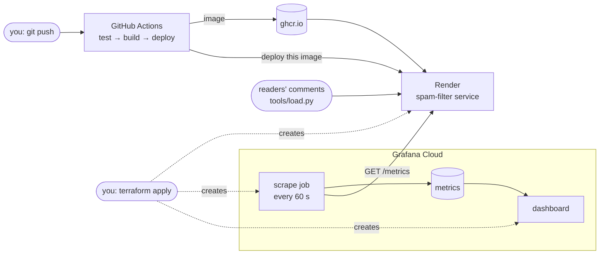
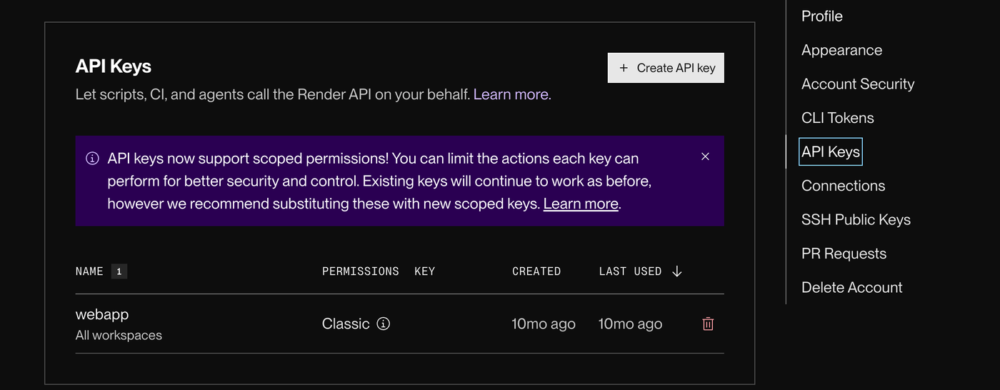

# Week 8 exercise: Operating the spam filter

* CMKL 41-645 Software Engineering for AI-Enabled Systems
* Week 8: Architecture and Design: Planning for Operations

**Individual homework · about 20 minutes of preparation + 55 minutes for the tasks**

## Learning outcomes

By the end of this exercise, you should be able to:

1. Instrument a service with counters and a histogram, and say which SLO each one lets you measure.
2. Explain how telemetry is collected (pulled from `/metrics`) and analyzed (queries and a dashboard).
3. Create cloud infrastructure with Terraform, and read a `terraform plan` before you apply it.
4. Write a CI/CD pipeline that only deploys tested, versioned images, and use it to roll back a bad release.

## Scenario

In the lecture, a blogging platform used an LLM to filter spam out of blog comments. In this exercise **you operate that spam filter**. The service is small (the "LLM" is a few keyword rules that sleep for a moment, like a slow model would), but everything around it is real: it runs on the internet, it reports telemetry, its infrastructure is code, and every push goes through a pipeline.



The four steps of the lecture map onto the tasks:

| Lecture | Here | Task |
|---|---|---|
| **Instrument** | `prometheus_client` counters and a histogram in the service | 1 |
| **CI/CD** | `.github/workflows/ci-cd.yml`: test → build image → deploy → smoke test | 2 |
| **Infrastructure as code** | Terraform creates the Render service, the scrape job and the dashboard | 3 |
| **Collect** | Grafana Cloud pulls `/metrics` every minute (like Prometheus) | 3 |
| **Analyze** | Dashboard and PromQL queries; check an SLO; catch and roll back a bad release | 4 |

The service has two SLOs:

* **Latency:** 99% of spam checks finish within **0.5 s**.
* **Quality:** the share of comments blocked as spam stays close to the share of spam (about 20% in our traffic).

Everything runs on free plans: **GitHub** (Codespaces, Actions, the ghcr.io image registry), **Render** (hosting) and **Grafana Cloud** (metrics and dashboards).

### The files

| File | What it does | Do you edit it? |
|---|---|---|
| `app/main.py` | The web service: `/`, `POST /check`, `/health`, `/metrics`. | **Task 1** (two TODOs) |
| `app/metrics.py` | The metrics the service exposes. | **Task 1** |
| `app/spam.py` | The "model": scores a comment; prompt `v1` or `v2`. | No, but read the docstring. |
| `app/config.py` | Which prompt version runs. | **Task 4** |
| `.github/workflows/ci-cd.yml` | The pipeline. The deploy job is missing. | **Task 2** |
| `infra/main.tf` | Terraform: providers, Render service, dashboard. | No, but read it. |
| `infra/scrape.tf` | Terraform: the Grafana Cloud scrape job. | **Task 3** |
| `infra/dashboard.json` | The dashboard, as code. | Stretch goal |
| `tools/check_setup.sh` | Checks your accounts and tokens. | No |
| `tools/render_deploy.sh` | Asks Render to deploy one image and waits until it is live. | No |
| `tools/load.py` | Sends readers' comments to your service. | No |
| `tests/` | Tests for Tasks 1 and 2. | No. Make them pass. |
| `solutions/` | Solutions to Tasks 1 to 3, for when you are really stuck. **Try on your own first.** | No |
| `REFLECTION.md` | Three short questions. | **Yes**, at the end. |

---

## Preparation (about 20 min)

Creating accounts and tokens takes time and needs your e-mail, so do it **first**, before you start the tasks. Sign up for Render and Grafana Cloud **with your GitHub account**: it is the fastest way.

> [!IMPORTANT]
> Treat every token like a password. Save tokens only as **secrets** (steps 4 and 5). Never write them in a file, a commit, or a chat. If a token leaks, delete it and create a new one.

1. **Fork** this repository into your own account. On your fork, open the **Actions** tab and click **"I understand my workflows, go ahead and enable them"**.

2. **Render** (hosting). Create a free account at [render.com](https://render.com).
   - Open **Account settings** (click your profile picture, top right), choose **API Keys** in the menu on the right, and click **+ Create API key**. Name it `se4ai-operations`. If Render asks which permissions the key gets, allow it to create, update and deploy services in your workspace. Copy the key: Render shows it only once.

     
   - If Render asks you for a credit card and you cannot add one, tell the instructor **before you continue**.

3. **Grafana Cloud** (metrics and dashboards). Create a free account at [grafana.com](https://grafana.com/auth/sign-up/create-user). You get a **stack**: your own Grafana at `https://<stack>.grafana.net`. The `<stack>` part is your **stack slug**.
   - **Access policy token.** At [grafana.com](https://grafana.com), open **My Account → Security → Access Policies → Create access policy**. Realm: your stack. Scopes: **stacks: Read** and **integration-management: Read and Write**. Then click **Add token** on the new policy and copy it (it starts with `glc_`).
   - **Service account token.** In your stack (`https://<stack>.grafana.net`), open **Administration → Users and access → Service accounts → Add service account**, role **Editor**. Then **Add service account token** and copy it (it starts with `glsa_`).

4. **Codespaces secrets** (used by Terraform in the Codespace). On GitHub: **your profile picture → Settings → Codespaces → Secrets → New secret**. Create these five, and for each one select your fork under **Repository access**:

   | Name | Value |
   |---|---|
   | `RENDER_API_KEY` | the Render API key |
   | `RENDER_OWNER_ID` | your Render workspace id: see step 6 |
   | `GRAFANA_STACK_SLUG` | your stack slug, for example `jdoe` |
   | `GRAFANA_CLOUD_ACCESS_POLICY_TOKEN` | the `glc_...` token |
   | `GRAFANA_SERVICE_ACCOUNT_TOKEN` | the `glsa_...` token |

5. **Actions secret** (used by the pipeline). On **your fork: Settings → Secrets and variables → Actions → Secrets → New repository secret**: `RENDER_API_KEY`, the same Render API key.

6. **Check.** On your fork, click **Code → Codespaces → Create codespace on main**. When it is ready, run in its terminal:
   ```bash
   tools/check_setup.sh
   ```
   The first time, it prints your Render workspace id (`tea-...`). Save it as the `RENDER_OWNER_ID` Codespaces secret, then **restart the Codespace** (Codespaces only read secrets when they start: on GitHub, **Code → Codespaces → ⋯ → Stop codespace**, then open it again). Run the check again until it says **All set.**

> **Stuck?**
> - `TF_VAR_... is not set` but you created the secret: did you give your fork access to it? Did you restart the Codespace after creating it?
> - **No Codespace?** You can work on your machine if you have Python 3.9+, Terraform 1.5+, `curl` and `jq`. Instead of Codespaces secrets, copy `infra/terraform.tfvars.example` to `infra/terraform.tfvars` and fill it in (it is in `.gitignore`).

---

## 0. Setup (3 min)

Open your Codespace. Run the tests:

```bash
python3 -m pytest -q
```

12 tests pass and 9 fail: the failing ones are Tasks 1 and 2.

> [!WARNING]
> **Solutions are in [`solutions/`](solutions/README.md). Try each task on your own first.** Use the **Stuck?** tips and ask a classmate or the TA before you look.

---

## Task 1. Instrument the service (10 min)

The operations team cannot check an SLO they cannot measure. Add the three metrics from the lecture to the service.

1. In `app/metrics.py`, define:
   - `REQUESTS`: a `Counter` named `spam_requests_total`, for every comment checked;
   - `SPAM`: a `Counter` named `spam_detected_total`, for comments flagged as spam;
   - `LATENCY`: a `Histogram` named `spam_inference_seconds`, for the time the model takes, with `buckets=LATENCY_BUCKETS`.
2. In `app/main.py`, in `check()`, use them: count the request, time the call to `spam.check(...)`, and count spam.

Check your work:

```bash
python3 -m pytest -q tests/test_metrics.py
flask --app app.main run --port 8080
```

In a **second terminal**, check a comment and look at the telemetry:

```bash
curl -s -X POST localhost:8080/check -H 'Content-Type: application/json' -d '{"text": "FREE crypto prize!!! http://x.io"}'
curl -s localhost:8080/metrics | grep spam_
```

Read the `spam_inference_seconds_bucket` lines. Each bucket counts the checks that took **at most** `le` seconds. **How would you compute the share of checks within 0.5 s from these lines?** (You will see the answer on the dashboard in Task 4.)

> **Stuck?**
> - `Counter("spam_requests_total", "Comments checked")`: a metric needs a name and a help text.
> - `with metrics.LATENCY.time():` times the block inside it. Only the model call should be inside.
> - `test_bad_requests_are_not_counted` fails? Count the request **after** the check for an empty comment.
> - Why `LATENCY_BUCKETS`? The default buckets have no boundary at exactly 0.5 s, so they could not tell you whether a check took 0.45 s or 0.55 s.

---

## Task 2. Complete the pipeline (8 min)

Open `.github/workflows/ci-cd.yml`. The `test` job runs the tests and checks the Terraform code. The `build` job packages the service as a container image and pushes it to `ghcr.io`, tagged with the **commit hash**: every version gets its own image, so you can always go back to an old one.

The `deploy` job is commented out. Uncomment it and replace the three `???`:

- `needs`: which job must succeed first? (The deploy also uses that job's output: the image name.)
- `if`: deploy **only from `main`**, and **only once the `RENDER_SERVICE_ID` repository variable is set**. You create that variable in Task 3; until then, the deploy must be skipped, not fail.
- `RENDER_API_KEY`: read it from the secret you saved during the preparation.

```bash
python3 -m pytest -q                 # everything passes now
git add -A
git commit -m "Instrument the service and add the deploy job"
git push
```

Open the **Actions** tab. The **ci-cd** run should show **test ✓ → build ✓ → deploy (skipped)**.

Then make the image public, so Render can download it: on GitHub, **your profile → Packages → se4ai-operations → Package settings → Change visibility → Public**.

> **Stuck?**
> - Workflow expressions look like `${{ ... }}`: `${{ secrets.NAME }}`, `${{ vars.NAME }}`. Inside `if:` you can leave out the `${{ }}`.
> - Combine two conditions with `&&`. The current branch is `github.ref`, and it looks like `refs/heads/main`.
> - An unset variable is the empty string `''`.
> - The `test` job fails on `terraform fmt`? You changed a `.tf` file: run `terraform -chdir=infra fmt`.

---

## Task 3. Create the infrastructure with Terraform (12 min)

Read `infra/main.tf`. It declares the Render service (free plan, running your image) and the dashboard. What is missing is **collection**: nobody reads `/metrics` yet.

1. Open `infra/scrape.tf`, uncomment the scrape job and replace the three `???`. The URL must be **the service's own URL** plus `/metrics`: refer to the `render_web_service` resource, do not paste a URL by hand.
2. Plan:
   ```bash
   cd infra
   terraform init
   terraform plan
   ```
   **Read the plan before you apply it.** How many resources will it create? Which values are `(known after apply)`, and why can Terraform not know them yet?
3. Apply. Type `yes` when asked. It takes 2 to 5 minutes while Render downloads and starts your image.
   ```bash
   terraform apply
   ```
4. Terraform prints its **outputs**. On your fork, open **Settings → Secrets and variables → Actions → Variables** and create two repository variables:
   - `RENDER_SERVICE_ID` = the `render_service_id` output;
   - `APP_URL` = the `app_url` output.
5. On the **Actions** tab, open your last **ci-cd** run and click **Re-run all jobs**. This time the deploy runs, and the smoke test checks that **your commit** is the one that is live.
6. Open `APP_URL` in your browser and check a few comments. Then try `curl -i <APP_URL>/metrics`. Why do you get `401`?

> **Stuck?**
> - A resource attribute is written `<type>.<name>.<attribute>`, for example `render_web_service.app.url`. Strings can contain `"${...}"`.
> - `app/main.py` reads `Authorization: Bearer <token>`. Which resource in `main.tf` holds the token, and which of its attributes is the value?
> - `Error: ... image ... not found` or `unauthorized` from Render: the image is not public yet (end of Task 2), or the build job has not run.
> - **`maintenance mode can only be configured for non-free tier services`**: the Render Terraform provider cannot **update** a service on the free plan (it can create one). If you changed the service in `main.tf`, recreate it: `terraform apply -replace=render_web_service.app` (the URL and service id stay the same only if the name does not change; update the variables if they do).
> - The first request to a free Render service after 15 idle minutes takes up to a minute: the service was asleep.

> **Why does Terraform not deploy new versions?** Terraform creates the service **once**. After that, the pipeline deploys each new image through the Render API. `ignore_changes = [runtime_source]` in `main.tf` tells Terraform not to undo those deploys. Infrastructure changes rarely; the code changes on every push.

---

## Task 4. Analyze the telemetry (15 min)

1. **Send traffic.** In a second terminal, send readers' comments for 5 minutes:
   ```bash
   python3 tools/load.py <APP_URL> --minutes 5
   ```
2. **Open the dashboard**: the `dashboard_url` output of Terraform (`terraform -chdir=infra output dashboard_url`). Data appears after 1 to 2 minutes: Grafana Cloud scrapes only once a minute. Read each panel. Is the **latency SLO** met? What share of comments is blocked?
3. **Write a query.** The panel **"p99 vs. SLO"** only shows the SLO line. Edit the panel (**⋮ → Edit**) and add a query for the **99th percentile** of the inference latency, then **Save dashboard**. Is the p99 line below the SLO line?
4. **Release a new prompt.** The data scientists say prompt `v2` "catches more spam". In `app/config.py`, change the default `"v1"` to `"v2"`. Commit and push. When the pipeline is green, run `tools/load.py` again for 5 minutes and watch the dashboard. What happened to the **version**, the **p99 latency**, the **SLO** and the **share of blocked comments**? On the service page, check the comment `Nice article, more here: https://example.org`.
5. **Roll back.** Real readers' comments are being blocked: roll back **now**, investigate later. On the **Actions** tab, open the **ci-cd** run of the commit **before** your v2 change and click **Re-run all jobs**. It redeploys that commit's image. Check `<APP_URL>/health` and the dashboard. Then make `main` match what is running: `git revert HEAD` and push.

> **Stuck?**
> - A quantile from a histogram: `histogram_quantile(0.99, sum by (le) (rate(spam_inference_seconds_bucket[5m])))`. Look at the **median** panel: you only need to change one number.
> - `rate(...[5m])` is the per-second increase over the last 5 minutes. With one scrape a minute, a window shorter than about 2 minutes has too few points.
> - The panel says **No data**: is `tools/load.py` running? Has it been 2 minutes? In Grafana, **Explore → Metrics**: do you see `spam_requests_total`? If not, check the scrape job under **Connections → Metrics Endpoint**.
> - Your saved panel disappears after a later `terraform apply`? The dashboard is code: Terraform puts back what `dashboard.json` says (see stretch goal A).

---

## Push and submit (2 min)

Answer the three questions in [`REFLECTION.md`](REFLECTION.md), add the screenshot it asks for, then commit and push.

Submit the URL of your fork. Your fork should show:

- [ ] a **green** ci-cd run on the latest commit, **with the deploy job**;
- [ ] `REFLECTION.md` filled in, with your service URL and a dashboard screenshot.

---

## Stretch goals (if you finish early)

### A. Put your query in the code (5 min)

Your p99 query lives only in Grafana, so the next `terraform apply` will remove it. Add it to the p99 panel's `targets` in `infra/dashboard.json` (copy the median panel's target and change it; `refId` must be `"B"`). Run `terraform -chdir=infra plan`: Terraform shows that it will update the dashboard. Apply it. Why is a dashboard in version control better than one edited by hand?

### B. A smoke test that would have stopped v2 (10 min)

The smoke test only checks `/health`, so the v2 release went live. Add a step to the deploy job that posts a **real comment with a link** to `<APP_URL>/check` and fails if it is blocked. Push a v2 commit again: the pipeline should now go **red**. Which version is live after the red run, and why is that a problem? How would a **canary release** (lecture) avoid it?

### C. Alert on the SLO, as code (15 min)

Add a `grafana_rule_group` resource to Terraform with one alert rule: fire when the share of checks within 0.5 s over 10 minutes is below 0.99 (the query of the **"Checks within 0.5 s"** stat panel). See the [`grafana_rule_group` documentation](https://registry.terraform.io/providers/grafana/grafana/latest/docs/resources/rule_group). Release v2 again and watch the alert fire under **Alerting → Alert rules**.

### D. Clean up

When the course no longer needs it, delete everything you created with one command: `terraform -chdir=infra destroy`. This is a benefit of infrastructure as code: nothing is forgotten.

---

## In industry

The pieces here are small versions of common tools. **Prometheus** scrapes `/metrics` the way Grafana Cloud does here, and **OpenTelemetry** is the vendor-neutral standard for producing metrics, logs and traces. Terraform (or OpenTofu, Pulumi) manages the infrastructure of most cloud teams, with the state stored in a shared backend (not on one laptop, as here) and `terraform plan` reviewed in pull requests. Deployments go to Kubernetes or a managed platform, often with canary releases that are rolled back automatically when an SLO is at risk.
